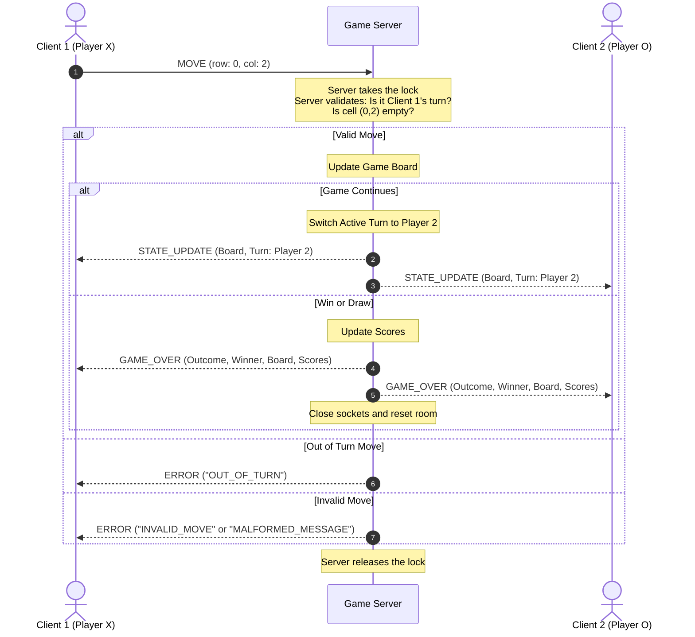

# Concurrency Design: Tic-Tac-Toe Server
 
**Student:** Dustin Headington | **Course:** CS 457 | **Sprint 2**
 
## 1. Concurrency Model: Multi-Threading
 
This server uses multi-threading. The main thread only accepts new connections. Each client gets its own worker thread that waits on `recv()`. This way a slow client never blocks the server or the other player. All the game data is kept in one shared `room` object, and one `threading.Lock` called `lock` protects it.
 
**Capacity:** the server runs one game at a time with exactly 2 players. That means 2 player worker threads, plus a short-lived thread for any extra client that gets rejected (see section 2, step 6).
 
## 2. Connection Lifecycle
 
1. **Startup (`INIT`):** the server creates the `room`, then calls `bind()` and `listen()`.
2. **Accept:** the main thread loops on `accept()` and starts a worker thread for each new socket.
3. **Register:** the worker reads `CONNECT` and registers the player while holding the lock. The first player becomes `Player_1` (`X`) and gets `LOBBY_WAIT`. The second player becomes `Player_2` (`O`) and the game starts. If the first player leaves while waiting, the server removes them and keeps waiting.
4. **Game:** the server sends `GAME_START` and `STATE_UPDATE` to both players. Each worker loops on `recv()` and handles every complete line. Every `MOVE` is handled while holding the lock.
5. **Teardown:** when someone wins, the game is a draw, or a player disconnects, the server sends `GAME_OVER` to each player who is still connected. Then it closes both sockets and resets the room (`CLEANUP`). Both workers exit after this.
6. **Extra client:** if the room is already full, a new `CONNECT` gets an `ERROR` (`MALFORMED_MESSAGE`) and its socket is closed. The blueprint has no room-full message, so this reuses `MALFORMED_MESSAGE`.
## 3. Thread Safety
 
### Shared resources
 
| Resource | What goes wrong without a lock |
|---|---|
| `board` | Two moves take the same cell |
| `turn` | Both players pass the turn check |
| `moves` | The draw check is wrong |
| `scores` | A score update gets lost or mixed up |
| `players` (name, symbol, socket) | A send goes to a closed socket |
| `state` | `GAME_OVER` and `CLEANUP` run twice |
| Client sockets (writes) | Two threads mix their bytes on one socket |
 
Each worker has its own `buffer`, so it does not need a lock.
 
### Lock strategy
 
`recv()` and framing happen **outside** the lock. Checking the move, changing the state, and sending messages all happen **inside** the lock.
 
```python
def handle_client(sock, room):
    buffer = LineReader()                  # private to this worker
    while True:
        try:
            data = sock.recv(4096)         # blocks outside the lock
        except (ConnectionResetError, ConnectionAbortedError, BrokenPipeError):
            data = b""                     # an error counts as a closed socket
        if data == b"":                    # peer closed
            with lock:
                player_left(room, sock)
            return
        for line in buffer.feed(data):
            with lock:                     # acquire
                handle_message(room, sock, line)
            # release (automatic)
```
 
Rules:
 
- The code uses `with lock:` so the lock is always released, even if an error happens.
- `threading.Lock` can't be taken twice by the same thread. So `handle_message` and `player_left` never take the lock themselves. They only run when the caller already holds it.
- The turn check and the board write happen in the same critical section. This means `turn` can't change in between.
- Both `STATE_UPDATE` sends (and both `GAME_OVER` sends) happen in the same critical section. This way both clients get the same state in the same order.
- A `DISCONNECT` message, a `recv()` that returns `b""`, a `recv()` error, or a failed `sendall()` all count as a disconnect.
- A disconnect needs the lock, so it is handled only after the current critical section finishes. If that step already decided a win or draw, the result stands. Otherwise the player who stayed gets `GAME_OVER` with `FORFEIT`.
- After `CLEANUP`, an old worker may wake up late from `recv()`. `handle_message` and `player_left` do nothing if `sock` is not in `players`, so an old worker can't change a new game.
- `GAME_OVER` and `CLEANUP` only run once. They are skipped if `state` is already past `PLAYER_TURN`.
### Turn enforcement
 
Only code that holds the lock can change `turn`. The turn check comes first, and a rejected move returns before anything is written. If both players send a `MOVE` at the same time, the lock lets the first one go first. The second one is then checked against the new turn and gets `OUT_OF_TURN`.
 
## 4. Sequence Diagram: Move, Validation, and Broadcast
 

 
**Narrative.** Player 1's worker thread receives the line and takes the lock. It checks the turn first, then the cell. If the move is valid, it updates the board. Then it does one of two things. If the game continues, it switches the turn and sends `STATE_UPDATE` to both players. If someone won or the board is full, it ends the game and sends `GAME_OVER` to both players. If the move is rejected, only the sender gets an `ERROR`, and the board and turn stay the same. The lock is only released after all the sends are done, so Player 2 never sees an old board.
 
## 5. Score and Leaderboard Synchronization
 
The scores are stored in memory inside the `room`, and `lock` protects them:
 
```python
scores = {"Player_1": 0, "Player_2": 0}
```
 
When a round ends, the winner gets `+1`. A draw changes nothing. This happens while the lock is still held. Then the worker builds one `GAME_OVER` message with `outcome`, `winner`, `board`, and `scores`, and sends the same message to both players. If only one player is left (a forfeit), only that player gets it. The scores are reset along with the room at `CLEANUP`.